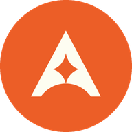

<p align="center"></p>

<h1 align="center">Aarka Tech</h1>

<p align="center">A free, local-first job-search workspace: find roles worldwide, see how well you fit, tailor your resume, and track every application and follow-up, on your own computer.</p>

<p align="center"><strong>Status: public alpha (0.1.0-alpha.1).</strong> Expect rough edges. See <a href="docs/KNOWN_LIMITATIONS.md">known limitations</a>.</p>

---

Aarka Tech is based on [career-ops](https://github.com/career-ops-hq/career-ops) by Santiago Fernández de Valderrama (MIT). It adds a redesigned web app, a scheduled local pipeline, a multi-provider AI configuration, Gmail draft-only integration and an encrypted personal-records vault. It is an independent fork and is not affiliated with or endorsed by the career-ops project. See [NOTICE.md](NOTICE.md).

## What it does

| Step | Where | Uses AI? |
|---|---|---|
| Build your career profile from your resume | My Career Hub | Optional (extraction) |
| Discover new roles on company career pages worldwide | Explore Jobs | No (free) |
| Filter by country, city, work mode, seniority, employment type, freshness | Explore Jobs | No |
| Favourite companies and get Dashboard alerts for their new roles | Explore Jobs | No |
| Evaluate a role against your profile: an A–H report with fit score, strengths, gaps and a verdict | Explore / Applications | Yes, your own provider |
| Generate a tailored resume and cover letter PDF | Applications | Yes, your own provider |
| Track applications on a stage board and in a table | Applications | No |
| Follow-up reminders | Follow-ups | No |
| Keep salary slips, ID and offer letters encrypted on your Mac | Documents › Personal records | Never |
| Run discovery on a schedule | Automation | No (AI stage is off by default) |
| **Human-in-the-loop:** Aarka Tech never submits an application, sends an email or contacts a recruiter; you always take the final step <!-- hitl: absolute guarantee. Do not add "automatically", "by itself", "without your permission" or any other hedge when translating this row. --> | Everywhere | — |

Nothing is ever sent, submitted or posted for you. Applications, emails and recruiter messages always need your own action; Gmail integration only creates drafts.

## Quick start

Requirements: Node.js 22.6 or newer, npm, Git. macOS is the primary platform for this alpha; Linux and Windows run the web app and scanner but not the Keychain-based features (see [limitations](docs/KNOWN_LIMITATIONS.md)).

```bash
git clone https://github.com/<you>/aarka-tech.git
cd aarka-tech
npm install
npm --prefix web ci
npm run doctor            # checks your setup, prints what's missing
npm --prefix web run build
npm --prefix web start    # http://127.0.0.1:3000
```

The first run opens onboarding. Upload your resume (PDF or text) and confirm what was extracted. To explore with fictional data instead, see [Try it with sample data](docs/INSTALL.md#try-it-with-sample-data).

Full instructions: [docs/INSTALL.md](docs/INSTALL.md). Problems: [docs/TROUBLESHOOTING.md](docs/TROUBLESHOOTING.md).

## AI providers (bring your own)

Aarka Tech does not include or resell AI. Job discovery, filtering, tracking and follow-ups work with no AI at all. For evaluations and tailored documents, connect one provider you already use in **Integrations & Settings**:

- Command-line tools you are signed in to: Claude Code, Codex, Gemini CLI, Qwen Code and others.
- API keys: Gemini API, Groq, Mistral, OpenRouter, Cloudflare Workers AI. Keys are stored in the macOS Keychain and never written to files, logs or the browser.

Your provider's own pricing, quotas and terms apply. Aarka Tech never enables a provider that may charge you without an explicit confirmation, and never falls back silently to a different provider. See [docs/PRIVACY.md](docs/PRIVACY.md#ai-providers).

## Using it from an AI coding agent

You can also drive Aarka Tech by chatting with an AI CLI opened in this folder (Claude Code, Codex,
Gemini CLI, OpenCode, Qwen Code). Ask in plain language, for example "evaluate this job: <url>"
or "scan for new roles". Each agent reads its own guide: [CLAUDE.md](CLAUDE.md), [CODEX.md](CODEX.md),
[GEMINI.md](GEMINI.md). With Codex, run it interactively (`codex`) or headless
(`codex exec "evaluate https://…"`); slash commands are not guaranteed in every agent, so a plain
prompt is the reliable way.

## Your data stays on your computer

Your resume, profile, tracker, reports and generated documents are plain files inside your checkout and are git-ignored. The web app listens on `127.0.0.1` only. Nothing is uploaded unless you choose an AI provider (which then receives the text of that task) or connect Gmail (drafts only). Details: [docs/PRIVACY.md](docs/PRIVACY.md).

## Documentation

- [Installation](docs/INSTALL.md) · [Troubleshooting](docs/TROUBLESHOOTING.md) · [Known limitations](docs/KNOWN_LIMITATIONS.md)
- [Privacy](docs/PRIVACY.md) · [Security policy](SECURITY.md) · [Contributing](CONTRIBUTING.md) · [Code of conduct](CODE_OF_CONDUCT.md)
- [Background automation](automation/README.md) · [Release process](docs/RELEASING.md) · [Release notes](docs/releases/0.1.0-alpha.1.md)
- Upstream career-ops documentation is kept in [docs/](docs/) and [docs/upstream/](docs/upstream/).

## License

MIT. See [LICENSE](LICENSE). The original career-ops copyright notice is preserved. Fonts are under the SIL Open Font License (see `web/src/assets/fonts/*/OFL.txt`).
